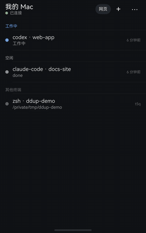

# DD-up

**English summary.** DD-up is a personal build of [Herdr](https://github.com/herdrdev/herdr-app) (v0.1.12, macOS Apple Silicon) with one host addition: mods get a `nativeView` element that hosts a native macOS view inside the mod's own bounds (frame synced at paint time, hidden under overlays, focus handed back to the terminal). On top of it, three ordinary mods and one layout:

- **files-plus**: the Files panel opens PDF (PDFKit), Word/Excel/PowerPoint/Pages/Numbers/Keynote and images (Quick Look), and audio/video (AVKit) right in the panel. Right-click a file for Show in Finder or Open with Default App (a folder: Open in Finder); a previewed file has the same choices under ⋯ in its header (`files-plus-menu` draws the menu). The panel speaks English or Chinese, following the macOS language.
- **browser**: a side browser panel (Chromium via CEF 156; WebKit fallback) with persistent logins, find, zoom, print, downloads, history, clear data, and an opt-in import of your Chrome cookies.
- **tabs-plus** and the `dd-up` layout: the official main layout with a "浏览器" (browser) button.
- **码上 (HarmonyOS phone app)** with `ddup-bridge` on the Mac: see every agent's state, conversation and terminal on the phone, answer permission prompts and questions there, get a push and a home-screen card when an agent waits for you. The phone talks to your own Mac directly (LAN or Tailscale), end-to-end encrypted; no server in between.

Not affiliated with the Herdr project. The host changes live in [`patches/herdr-app/`](patches/herdr-app/), so they're easy to review against upstream.

---

DD-up 是在官方 Herdr 上加了一个小扩展的个人构建：在 Herdr 主窗口里直接看文件、播音视频、用侧边浏览器，文件树、工作区和 Agent 终端都照旧。

## 能做什么

| 功能 | 说明 |
|---|---|
| Files 里直接打开文件 | PDF（多页、可选中复制）、Word/Excel/PowerPoint、Pages/Numbers/Keynote、RTF、图片（含 SVG）、MP4/MOV/M4V、MP3/WAV/M4A/AAC/AIFF。代码和文本仍然用官方的只读代码视图 |
| 侧边浏览器 | 顶栏点"浏览器"，输入网址就能用；登录状态会保存。⋯ 菜单里有：在页面中查找、打印、缩放、下载、历史记录、导入 Chrome 登录、清除浏览数据 |
| 不影响原有使用 | 和官方 Herdr 共用同一套工作区、终端、Agent 和设置（同一个 herdr-core） |

## 手机 App：码上（鸿蒙）



在鸿蒙手机上看 Mac 里所有 Agent（Claude Code、Codex 等）：

- 谁在等你、谁在工作、谁做完了，一眼看到；
- 默认看对话，也能切到终端看原始画面；
- 权限确认和选项题直接在手机上点，不用回到电脑前；
- Agent 等你时收到推送，桌面卡片上也能直接点按钮回答。

连接方式：Mac 上运行 `ddup-bridge`（`bridge/`），它连本机的 herdr-core。手机通过局域网或 Tailscale 直接连你自己的 Mac，不经过任何中转服务器。扫码配对时，手机记下这台 Mac 的公钥；之后的通信用 X25519 + AES-256-GCM 端到端加密。

限制：

- App 还没上架，要用自己的华为开发者账号签名安装。推送要用你自己在 AppGallery Connect 建的项目和 Push Kit 服务账号密钥；这些都放在本地，不进仓库。
- 在外面使用要靠 Tailscale（手机端可用 MeshArc）。如果 Mac 上开着占用 VPN 通道的代理 App，用 `scripts/tailscale-service` 跑一个不占 VPN 通道的 userspace 节点。

安装和使用见 [`docs/harmony/SETUP.md`](docs/harmony/SETUP.md)，协议和设计见 [`docs/harmony/DESIGN.md`](docs/harmony/DESIGN.md)。

<br clear="right">

## 现状和限制

- 只支持 **macOS、Apple Silicon**，跟随 Herdr **0.1.12**。官方升级后需要重新打补丁、编译，**不会自动更新**。
- 应用没有 Apple 开发者签名，只有本机临时签名，所以目前只能**从源码编译安装**。
- 浏览器内核是 Chromium（CEF 156），应用约 390 MB。不支持 Chrome 扩展程序，也不支持 `chrome://` 页面。
- 远程机器上的文件暂时不能内嵌预览。
- 早期版本：自检测试通过，界面交互还在作者本机日用验证中。逐项状态见 [`docs/SUPPORT_MATRIX.md`](docs/SUPPORT_MATRIX.md) 和 [`docs/ACCEPTANCE.md`](docs/ACCEPTANCE.md)。

## 从源码安装

需要 macOS（Apple Silicon）、Command Line Tools（`xcode-select --install`）、[uv](https://docs.astral.sh/uv/)、git，以及已安装并打开过一次的官方 Herdr 0.1.12。工具链全部装在仓库内的 `.local/`，不修改全局环境。

```sh
git clone https://github.com/obqyuxi/herdr-universal-preview && cd herdr-universal-preview
scripts/bootstrap-toolchain   # Rust 1.95.0、Zig 0.16.0、cmake/ninja、CEF 156（约 1–2 GB 下载）
scripts/prepare-upstream      # 克隆 herdr-app v0.1.12，应用 patches/herdr-app
scripts/build --daily         # 编译并打包 artifacts/apps.noindex/DD-up.app
scripts/install --dry-run     # 先看会新增什么
scripts/install
```

然后在官方 Herdr 里按 ⌘Q（终端和 Agent 会继续运行），打开 `~/Applications/DD-up.app`，按 ctrl-shift-l 选择 `dd-up` 布局。两个 App 共用同一套数据，同一时间只开一个。

安装只**新增**以下内容，不覆盖 `/Applications/Herdr.app`、官方内置的 mod 和布局：

- `~/Applications/DD-up.app`；
- 3 个 mod（`files-plus`、`browser`、`tabs-plus`）；
- 1 个布局（`dd-up`）。

每项都记录在带内容指纹的清单里。细节见 [`docs/INSTALL.md`](docs/INSTALL.md)。

## 卸载 / 回到官方 Herdr

```sh
scripts/rollback      # 删掉安装时新增的东西（改动过的会保留），再打开官方 Herdr
scripts/uninstall --purge-data   # 同时删除 DD-up 自己的浏览器资料
```

## 隐私

- 浏览器资料单独存放在 `~/Library/Application Support/DD-up/Chromium`，不读取、也不改动你的 Chrome 或 Safari 资料。
- 内嵌浏览器默认不使用 macOS 钥匙串（避免每次更新都弹窗，也不和其他基于 Chromium 的程序共用 "Chromium Safe Storage"）。Cookie 文件只靠 macOS 账户权限保护。想改用钥匙串，设置 `HUP_CHROMIUM_SYSTEM_KEYCHAIN=1`。
- "导入 Chrome 登录"只在你点击并确认后运行。macOS 会弹出钥匙串授权，只导入 Cookie，不导入密码。全程只在本机进行，不记日志，也不上传。

## 原理

官方 Herdr 的 mod 只能画 GPUI 元素，无法嵌入原生视图。社区里已经有过相关讨论：[#218](https://github.com/herdrdev/herdr-app/issues/218)、[#91](https://github.com/herdrdev/herdr-app/issues/91)、[#235](https://github.com/herdrdev/herdr-app/pull/235)。本项目给宿主加了一个窄接口：

- 元素：`herdr.nativeView.new(id, { kind, url | path })`，`kind` 可以是 `web`、`pdf`、`media`、`quicklook` 或 `chromium`；
- 函数：`nativeViewCapabilities()`、`nativeViewCall(id, action, args)`（按渲染器白名单分发）、`nextNativeViewEvent()`。

布局仍然只用 `{ "mod": ..., "props": ... }`，没有新增布局变体，官方版本照样能解析。

| 目录 | 内容 |
|---|---|
| `native/herdr-native-view` | 原生渲染器（objc2：WKWebView、PDFView、AVPlayerView、QLPreviewView，以及 CEF） |
| `patches/herdr-app` | 宿主粘合补丁，在 v0.1.12 上用 `git am` 应用 |
| `mods/`、`layouts/` | 上面说的 mod 和布局 |
| `brand.env`、`assets/icon` | 名称和图标 |
| `bridge/` | `ddup-bridge`：手机 App 和 Mac 之间的桥接服务（Rust） |
| `mobile/harmony/` | 鸿蒙 App“码上”（ArkTS） |
| `docs/` | 决策、能力矩阵、进度和验收记录 |

开发用的隔离测试环境（独立的 home、core 和 session，不碰正式 Herdr）见 `scripts/dev --help` 和 [`docs/ENVIRONMENT.md`](docs/ENVIRONMENT.md)。

## 许可

Apache-2.0，与 Herdr 相同，见 [`LICENSE`](LICENSE)。第三方组件（包括 CEF/Chromium）见 [`THIRD_PARTY_NOTICES.md`](THIRD_PARTY_NOTICES.md)。
